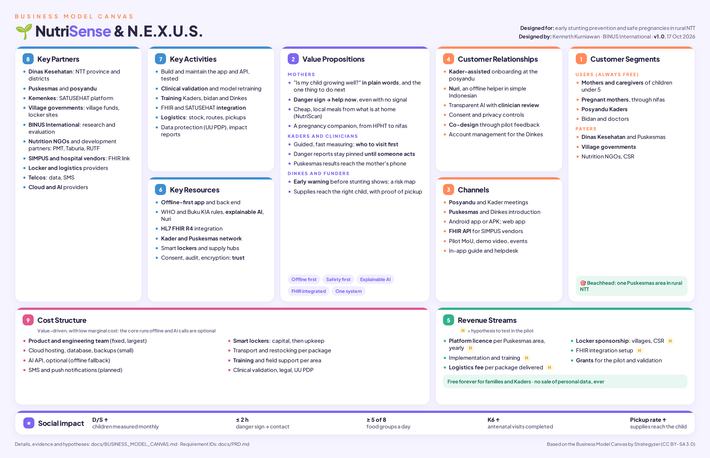

# NutriSense & N.E.X.U.S.: Business Model Canvas

| | |
|---|---|
| **Version** | 1.0, 17 October 2026 |
| **Owner** | Kenneth Kurniawan, BINUS International (thesis project) |
| **Related** | [PRD](PRD.md) (requirement IDs such as `MAT-07`) · [Product review and backlog](PRODUCT.md) · [ERD](ERD.md) |

A printable version is in [`images/business-model-canvas.pdf`](images/business-model-canvas.pdf).

**The model in one sentence.** NutriSense is free for the families and Kaders who use it, and is paid for by the
public-health system that is responsible for stunting and maternal health. That means district health offices,
Puskesmas and village governments, supported by grants and partners. The N.E.X.U.S. logistics layer earns a service
fee for each nutrition package it delivers.

This is a **social and public-sector model** (B2G, business to government), not a consumer app: the people who benefit
most are the least able to pay. Everything in *italics* below is a **hypothesis to test in the pilot** (see
[§11](#11-hypotheses-to-test-in-the-pilot)), not a fact.

---

## 1. Customer segments

NutriSense is a multi-sided platform: the **users** and the **payers** are different people.

| Segment | Role | Pays? |
|---|---|---|
| **Mothers and caregivers** of children under five in rural NTT | Main users: measure, feed, report symptoms | No, always free |
| **Pregnant mothers** (*ibu hamil*), through birth and nifas | Main users: check-ups, TTD, danger signs | No, always free |
| **Posyandu Kaders** (volunteers) | Field users: measure, visit, follow up | No, always free |
| **Bidan and doctors** at the Puskesmas | Clinical users: review, refer, follow up | Through their Puskesmas |
| **Dinas Kesehatan** (district and province) | Buyer and user: dashboards, approvals, logistics | *Yes: yearly licence* |
| **Village governments** (*pemerintah desa*) | Co-funder for their village's posyandu and lockers | *Yes: from village funds* |
| **NGOs, development partners, CSR programmes** | Run nutrition programmes and need delivery and data | *Yes: programme fees or sponsorship* |

**Beachhead.** One Puskesmas area in a rural NTT district, with its Kaders and posyandu ([PRODUCT.md, open
question 1](PRODUCT.md#7-open-questions-for-the-owner)).

## 2. Value propositions

| For | Value | Built in the app |
|---|---|---|
| **Mothers** | Know in plain words whether the child is growing well and the one thing to do next; danger signs answered at once, even offline; cheap local meals from what is at home; a pregnancy companion from HPHT to nifas | GRW-08, SYM-03, NUT-01, MAT-01–11 |
| **Kaders** | Measure faster with guidance; one list of who to visit first; danger reports that stay pinned until someone acts; works without signal | GRW-02, CAS-04, MAT-07–08, OFF-01 |
| **Bidan and doctors** | Flagged children with the reasons; Puskesmas check-ups reach the mother's phone automatically (FHIR); a referral loop with contact and outcome | RSK-03–05, FAC-01–04, MAT-07 |
| **Dinkes** | Early warning before stunting is visible; a village risk map and priority list; maternal indicators (KEK, anaemia, K1/K6); targeted supply delivery with reasons | GRW-07, DSH-01–05, LOG-02 |
| **Village governments** | Evidence that village money spent on stunting reaches the right children | DSH, LOG |
| **Partners and CSR** | Packages delivered to the right child, with a pickup record per package; outcome indicators per area | LOG-04–05, §10 metrics |

**Differentiators**
- **Offline first.** It works on a low-end phone with no signal.
- **Safety first.** Rules can only raise the AI's risk level, never lower it, and every danger sign is followed up.
- **Explainable AI**, not a black box.
- **Integrated.** It connects to the Puskesmas through HL7 FHIR R4 instead of adding another register.
- **One system for the whole chain:** family, Kader, clinic, Dinkes and supply.

## 3. Channels

| Phase | Channel |
|---|---|
| Awareness | The Dinkes and the Puskesmas, who introduce it to Kaders at the monthly meeting; the posyandu, where Kaders show it to mothers; thesis and demo presentations; health-innovation events |
| Evaluation | A pilot agreement (MoU) with one district's Dinkes; a demo video and the live demo |
| Purchase | Public procurement or a cooperation agreement with the Dinkes; village budget planning (*musyawarah desa*) for village co-funding |
| Delivery | Android app (Play Store or a direct APK for shared phones), the web app for Puskesmas and Dinkes desktops, and the FHIR API for SIMPUS vendors |
| After sale | Kader training at the Puskesmas; in-app help (Tanya Nuri, the user guide); a helpdesk for Puskesmas staff |

## 4. Customer relationships

- **Assisted onboarding.** The Kader registers mothers who have no email, by phone number (AUTH-08), and teaches them at
  the posyandu.
- **Self-service with a companion.** Nuri answers questions offline, in simple Indonesian, with safety first (AST-01, AST-02).
- **Trust through transparency.** Consent per scope, privacy controls, explained AI results, a clinician's review, and
  notes shared from the health worker (GOV-01, RSK-03, CAS-03).
- **Co-creation.** Pilot feedback from mothers, Kaders and bidan decides what is built next (the feature arena and
  [PRODUCT.md](PRODUCT.md)).
- **Account management for the Dinkes**: training, monthly reports and a named contact.

## 5. Revenue streams

| Stream | Who pays | Model |
|---|---|---|
| **Platform licence** (dashboards, Puskesmas use, support) | Dinkes, Puskesmas (from health operational funds such as BOK) | *Yearly subscription per Puskesmas area* |
| **Implementation and training** | Dinkes or programme partner | *One-off fee per area: setup, data migration, Kader training* |
| **N.E.X.U.S. logistics service** | Programme owner (Dinkes, partner, CSR) | *Fee per package delivered and picked up, or per locker per month* |
| **Locker sponsorship** | Village government (village funds), CSR | *Sponsor a posyandu locker: hardware plus upkeep* |
| **Integration** | SIMPUS vendors, hospitals | *Setup fee for the FHIR connection* |
| **Grants** | Research and innovation grants, development partners | Funds the pilot and the clinical validation |

**Free forever for families and Kaders.** NutriSense **never sells personal data**. Aggregated, anonymised reports are
shared only for public-health purposes, and research use needs the family's `research_use` consent (GOV-01).

## 6. Key resources

- **The platform**: the Expo app (Android, iOS, web), the FastAPI back end and the offline sync (PRD §6).
- **Clinical and AI knowledge in code**: the WHO 2006 growth tables, Buku KIA schedules, IMCI danger signs, the
  explainable risk model, NutriScan with 32 local foods and 22 recipes, and Nuri.
- **The integration**: the HL7 FHIR R4 inbound API, the SATUSEHAT-ready export and per-facility keys.
- **People**: the product and engineering team; clinical advisors (to recruit, for sign-off); trainers.
- **The network**: Kaders, posyandu and Puskesmas, through the Dinkes partnership.
- **Physical**: smart lockers and supply hubs, simulated in the prototype.
- **Trust assets**: consent records, the audit trail, the encryption and the evaluation results.

## 7. Key activities

- Build and maintain the app and the back end, with automated tests (422 backend tests, 83 feature checks).
- **Clinical validation and sign-off** of the danger wording and the rules (Buku KIA, MTBS), and **retraining** the
  model on consented real data.
- **Training and supporting** Kaders, bidan and Dinkes staff.
- **Integration** with Puskesmas systems and SATUSEHAT.
- **Logistics operations**: stock, routes, locker restocking and pickup codes.
- **Data protection and security**: consent, audit, encryption and UU PDP compliance.
- **Impact measurement and reporting** to the Dinkes and funders ([§10](#10-impact-and-key-metrics)).

## 8. Key partners

| Partner | What they bring |
|---|---|
| **Dinas Kesehatan** (district, NTT province) | Mandate, buyer, access to Puskesmas and Kaders, reporting needs |
| **Puskesmas and posyandu** | Clinical staff, Kaders, the monthly posyandu day |
| **Kemenkes** (SATUSEHAT) | The national health data platform and its standards |
| **Village governments** | Village funds for stunting prevention, posyandu space, locker sites |
| **Universities** (BINUS International) | Research, evaluation, students |
| **Development partners and NGOs** working on nutrition | Programmes, supplements (PMT, Taburia, RUTF), funding, field experience |
| **SIMPUS and hospital system vendors** | Sending check-ups to the app through FHIR |
| **Locker hardware and logistics providers** | Lockers, couriers, supply hubs |
| **Telecom operators** | Data and SMS for alerts and reminders (planned, GOV-08) |
| **Cloud and AI providers** | Hosting; the optional Claude API for photo recognition and open chat |

## 9. Cost structure

The cost structure is **value-driven, with low marginal cost**: the core works offline on cheap phones, and AI calls are
optional with an offline fallback, so costs grow slowly with each new family.

| Cost | Type | Note |
|---|---|---|
| Product and engineering team | Fixed | The largest cost |
| Cloud hosting, database, backups | Variable (small) | One Docker image; SQLite or PostgreSQL |
| AI API usage | Variable, optional | Only photo recognition and open chat; everything else runs offline |
| SMS and push notifications | Variable | Planned (GOV-08) |
| Smart lockers and hubs | Capital, then upkeep | Can be sponsored by villages or CSR (§5) |
| Transport and restocking | Variable per package | Covered by the logistics fee |
| Training and field support | Semi-variable per area | Kader and Puskesmas training |
| Clinical validation, legal and data protection | Fixed, up front | Sign-off of the danger wording; UU PDP review |

---

## 10. Impact and key metrics

The canvas has one more box for a social business: **impact**. These come from the [PRD §9](PRD.md#9-success-metrics):

| Impact | Metric |
|---|---|
| Stunting found earlier | D/S (children measured each month), 2T and "sliding toward −2 SD" flags |
| Danger signs reach care | Maternal danger reports contacted within 2 hours and closed within 24 hours |
| Better feeding | Children eating at least 5 of 8 food groups; TTD taken by KEK and anaemic mothers |
| Pregnancies on track | K6 coverage; K1 in trimester 1; KF1 and KN1 within 48 hours |
| Supplies reach the right child | Pickup rate; hours from ready to pickup |

## 11. Hypotheses to test in the pilot

| # | Hypothesis | How to test |
|---|---|---|
| H1 | Enough mothers have their own or a shared smartphone | Count in the pilot villages; if under half, add SMS and Kader-assisted use |
| H2 | The Dinkes will pay a yearly licence from existing health budgets (for example BOK) | Price interview and a pilot MoU with a priced option |
| H3 | Villages will co-fund lockers from village funds | Present at the village budget meeting in one pilot village |
| H4 | Programme partners will pay a fee per delivered package | Run one partner's supplement programme through N.E.X.U.S. |
| H5 | Kaders use it every posyandu day without pay | Usage logs: measurements per Kader per month |
| H6 | Following up danger signs improves time to care | Compare contact and outcome times before and after |
| H7 | Puskesmas systems can send check-ups through FHIR | One SIMPUS vendor connection |
