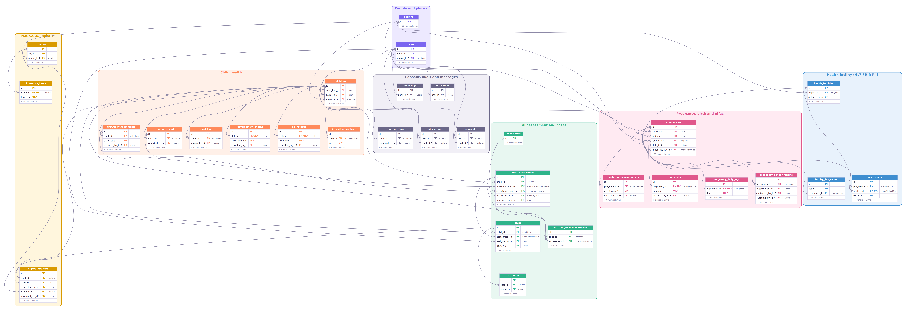
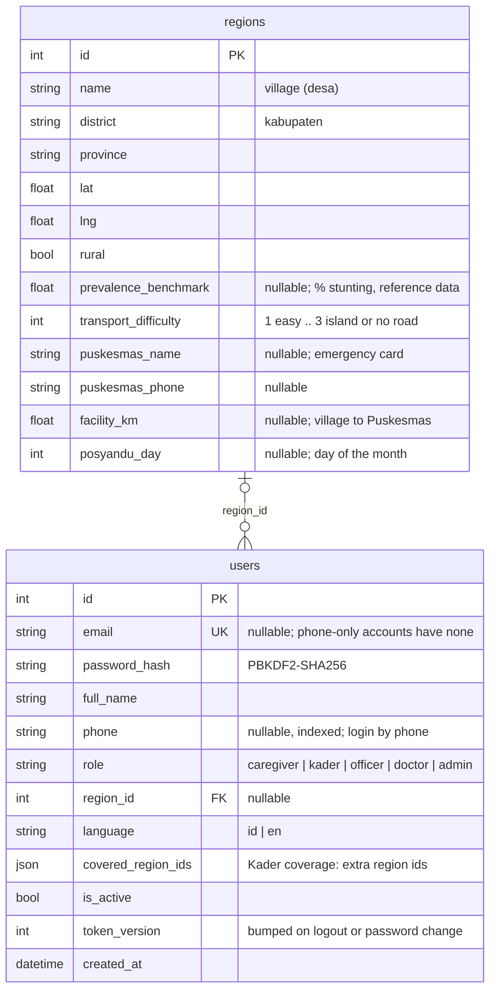
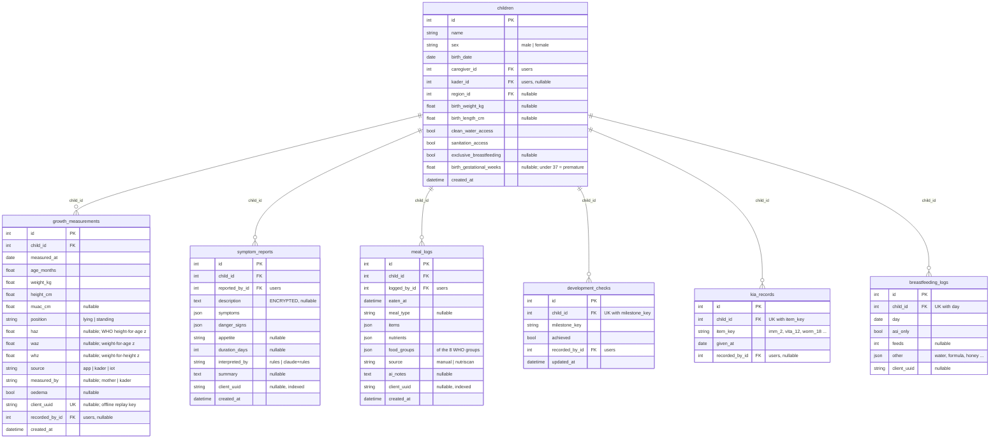
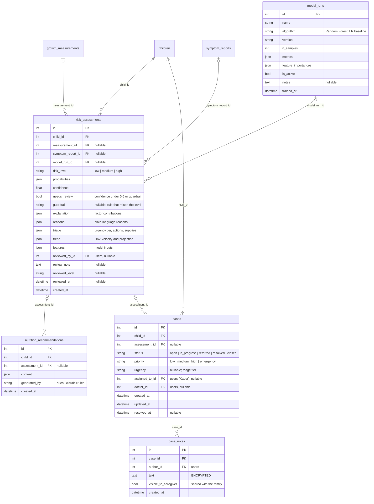
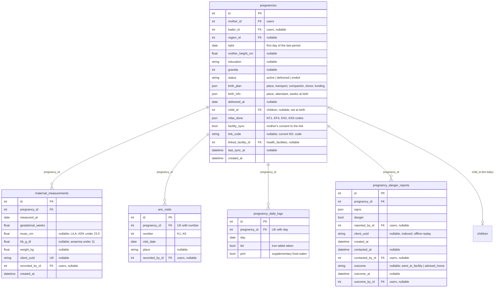
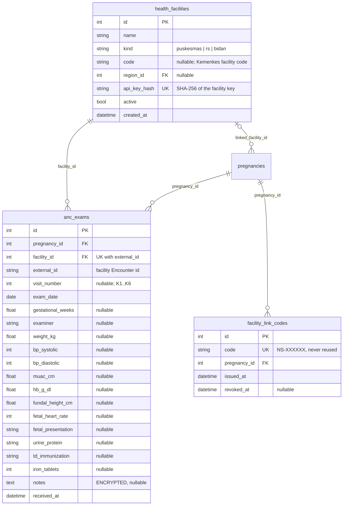
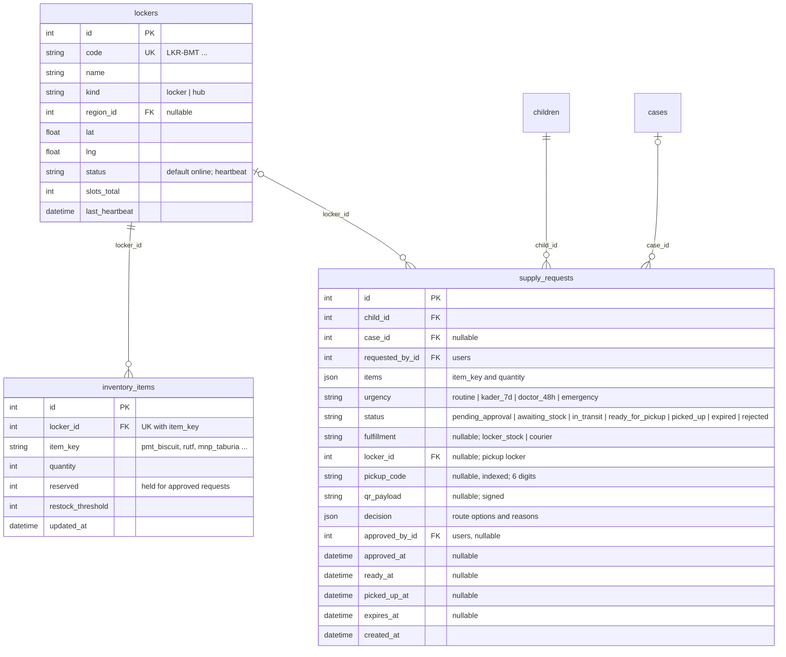
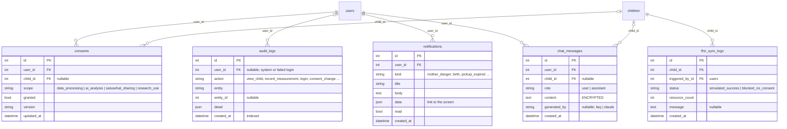

# NutriSense & N.E.X.U.S.: Entity Relationship Diagram (ERD)

| | |
|---|---|
| **Source of truth** | [`backend/app/models.py`](../backend/app/models.py) (SQLAlchemy 2), at commit `90d64d9` |
| **Database** | SQLite for demos and tests, PostgreSQL in production. Columns added after the first release are created on start-up by `database.py` (`_ADDED_COLUMNS`). |
| **Size** | 30 tables in 7 areas |
| **Related** | [PRD](PRD.md) (requirement IDs such as `MAT-07` are used below) · [Facility integration](FACILITY_INTEGRATION.md) |

The overview is generated from the models by [`backend/scripts/erd_dot.py`](../backend/scripts/erd_dot.py) (Graphviz), so
it cannot drift from the code: [`images/erd.svg`](images/erd.svg) (vector, for the thesis document) and
[`images/erd.png`](images/erd.png). The diagrams per area are written in [Mermaid](https://mermaid.js.org/) and render on
GitHub. A test (`backend/tests/test_erd_doc.py`) fails if a table is added to the models but not to this document.

How to read the diagrams:
- `||` exactly one, `|o` zero or one, `o{` zero or many.
- A line drawn from `users` means a foreign key to `users.id`; its label says which column (for example `mother_id`).
- `PK` primary key, `FK` foreign key, `UK` unique. Every table has an integer `id` primary key.
- Times are stored as timezone-aware UTC (`UTCDateTime`). `json` columns hold lists or objects (SQLite JSON, PostgreSQL JSON).

---

## 1. Overview



Each box lists the table's keys: `PK` primary key, `FK` foreign key (with the table it points to), `UK` unique, `UK*` part
of a unique pair, and `?` for a column that may be empty. The other columns are counted at the bottom of each box and
listed in the diagrams per area below. On a line, `||` means exactly one, `|o` zero or one and `o<` zero or many.
Staff columns that point to `users` (who recorded, reviewed, approved or followed up) are listed in the boxes but not
drawn as lines, to keep the picture readable; they are all in [§9](#9-foreign-keys-to-users).

To regenerate after a model change:

```sh
cd backend
python scripts/erd_dot.py > /tmp/erd.dot
dot -Tsvg /tmp/erd.dot -o ../docs/images/erd.svg
dot -Tpng -Gdpi=150 /tmp/erd.dot -o ../docs/images/erd.png
```

---

## 2. People and places



| Table | What one row is | Rules |
|---|---|---|
| `regions` | A village (desa) with its district, the nearest Puskesmas and the posyandu day | Read-mostly reference data, seeded |
| `users` | A person who logs in. A mother is a `caregiver`, whether she has a child, a pregnancy or both | Log in by `email` or `phone`. A Kader's coverage is `region_id` plus `covered_region_ids` (AUTH-04). Raising `token_version` revokes every session (AUTH-06) |

---

## 3. Child health



| Table | What one row is | Rules |
|---|---|---|
| `children` | A child under five | Owned by one caregiver (`caregiver_id`), followed by one Kader (`kader_id`). Deleting a child deletes all its rows in the tables of this section, its assessments, cases, requests and links (GOV-05) |
| `growth_measurements` | One weighing and height measurement | z-scores computed by the server from the WHO 2006 tables (GRW-03). `client_uuid` is unique, so an offline replay never creates a second row (OFF-02) |
| `symptom_reports` | One symptom report | The free-text `description` is encrypted at rest (GOV-04). `danger_signs` drives the emergency screen (SYM-03) |
| `meal_logs` | One meal | `food_groups` feeds the diversity ring (NUT-04) |
| `development_checks` | The answer to one age milestone | One row per child and milestone |
| `kia_records` | A Buku KIA item marked as given | One row per child and item. The schedule itself is code (`ai/kia.py`), not a table |
| `breastfeeding_logs` | One day of the ASI eksklusif tracker | One row per child and day, so a resend of the same day updates it |

---

## 4. AI assessment and cases



| Table | What one row is | Rules |
|---|---|---|
| `model_runs` | One trained version of the risk model | One active version at a time (`is_active`); retraining adds a row (RSK-08) |
| `risk_assessments` | The result of assessing a child, usually after a measurement or a symptom report | The model's level can only be raised by `guardrail` rules (RSK-02). A doctor's review fills the `reviewed_*` columns and keeps the original (RSK-05) |
| `nutrition_recommendations` | Feeding advice produced for an assessment | |
| `cases` | A child who needs follow-up by the Kader or doctor | Opened by a high, emergency or review result (CAS-01). `urgency` copies the triage tier (`emergency`, `doctor_48h`, `kader_7d`) |
| `case_notes` | A note on a case | Encrypted. A note with `visible_to_caregiver` shows in the mother's app (CAS-03) |

---

## 5. Pregnancy, birth and nifas



| Table | What one row is | Rules |
|---|---|---|
| `pregnancies` | One pregnancy, from the HPHT through birth and the 42-day nifas | The due date, trimester, K1–K6 windows and risk are computed, not stored (MAT-01, MAT-05). At birth, `child_id` points to the new child row (MAT-10) |
| `maternal_measurements` | One LiLA and Hb record | `client_uuid` unique (offline) |
| `anc_visits` | One completed antenatal visit, K1–K6 | One row per pregnancy and visit number |
| `pregnancy_daily_logs` | One day of TTD and PMT | One row per pregnancy and day |
| `pregnancy_danger_reports` | One danger-sign report by the mother | **Open** while `danger` is true, `outcome` is empty and it is under 14 days old. An open report keeps the mother urgent, even after a later minor complaint (MAT-07). "Not reached" does not set `outcome`; it is written to `audit_logs` as an attempt, so the report stays open |

---

## 6. Check-ups from the health facility (HL7 FHIR R4)



| Table | What one row is | Rules |
|---|---|---|
| `health_facilities` | A Puskesmas, hospital or midwife practice whose system sends check-ups | Only the SHA-256 hash of its API key is stored (FAC-02) |
| `facility_link_codes` | Every link code ever issued | `code` is unique and never reissued, so a code a facility still holds after the mother revoked it cannot reach another mother (FAC-03) |
| `anc_exams` | One check-up received from a facility | Unique on (`facility_id`, `external_id`): a resend updates the row, never duplicates it (FAC-03) |

---

## 7. N.E.X.U.S. logistics



| Table | What one row is | Rules |
|---|---|---|
| `lockers` | A smart locker at a posyandu (`kind = locker`) or a supply hub that restocks lockers by road (`kind = hub`) | Hardware is simulated |
| `inventory_items` | The stock of one item in one locker | One row per locker and item. Available = `quantity` − `reserved` (LOG-06) |
| `supply_requests` | A package for one child | Lifecycle: `pending_approval` → approved with stock reserved and a route chosen (LOG-02, LOG-03): `ready_for_pickup` at once from locker stock, or `in_transit` (or `awaiting_stock`) for a road delivery → `ready_for_pickup` with a code and QR (LOG-04) → `picked_up` (LOG-05). It can also end `rejected` or `expired`. `decision` keeps the reasons shown to the officer |

---

## 8. Consent, audit, notifications and assistant



| Table | What one row is | Rules |
|---|---|---|
| `consents` | A consent decision for one scope | Each change adds a row, and the newest row counts. `data_processing` cannot be withdrawn in the app; AI calls and SATUSEHAT sharing check their scope first (GOV-01, GOV-02) |
| `audit_logs` | One action on personal data | Written on every read and write of child and pregnancy data, consent changes, logins and staff follow-up, including `danger_not_reached` attempts (GOV-03). Append-only |
| `notifications` | One in-app message | Created by the server for results, cases, danger reports, births, packages and facility results (GOV-07) |
| `chat_messages` | One message to or from Nuri | Encrypted. `generated_by` tells the offline FAQ (`faq`) from Claude (`claude`) (AST-01, AST-03) |
| `fhir_sync_logs` | One FHIR export or simulated SATUSEHAT sync | `blocked_no_consent` when the family has not agreed to sharing (GOV-06) |

---

## 9. Foreign keys to `users`

Many tables record **who** did something. Every column below is a foreign key to `users.id`:

| Table | Column | Meaning | Required |
|---|---|---|---|
| `children` | `caregiver_id` | The mother or carer who owns the record | yes |
| `children` | `kader_id` | The Kader who follows the child | no |
| `pregnancies` | `mother_id` | The pregnant mother | yes |
| `pregnancies` | `kader_id` | Her Kader | no |
| `growth_measurements`, `maternal_measurements`, `anc_visits`, `kia_records`, `development_checks` | `recorded_by_id` | Who entered it | `development_checks`: yes; others: no |
| `symptom_reports` | `reported_by_id` | Who reported | yes |
| `meal_logs` | `logged_by_id` | Who logged | yes |
| `risk_assessments` | `reviewed_by_id` | The doctor or officer who reviewed the AI result | no |
| `cases` | `assigned_to_id`, `doctor_id` | The Kader and the doctor on the case | no |
| `case_notes` | `author_id` | Who wrote the note | yes |
| `supply_requests` | `requested_by_id`, `approved_by_id` | Who asked and who approved | requested: yes |
| `pregnancy_danger_reports` | `reported_by_id`, `contacted_by_id`, `outcome_by_id` | Who reported, who called the mother, who recorded the outcome | no |
| `consents`, `notifications`, `chat_messages` | `user_id` | The owner | yes |
| `audit_logs` | `user_id` | Who acted (empty for the system or a failed login) | no |
| `fhir_sync_logs` | `triggered_by_id` | Who started the export | yes |

## 10. Rules that cut across tables

| Rule | Where | Why |
|---|---|---|
| **Offline idempotency.** `client_uuid` on `growth_measurements` and `maternal_measurements` (unique), and on `symptom_reports`, `meal_logs`, `breastfeeding_logs` and `pregnancy_danger_reports` (checked by the server). Day-based tables are unique on (owner, `day`) | OFF-02 | A report replayed after the signal returns is stored once |
| **Encryption at rest.** `symptom_reports.description`, `case_notes.text`, `chat_messages.content`, `anc_exams.notes` use `EncryptedText` (Fernet, key `NUTRISENSE_ENCRYPTION_KEY`) | GOV-04 | Free text can hold anything; a database copy without the key cannot read it |
| **Unique pairs.** (`child_id`, `milestone_key`), (`child_id`, `item_key`), (`child_id`, `day`), (`pregnancy_id`, `number`), (`pregnancy_id`, `day`), (`locker_id`, `item_key`), (`facility_id`, `external_id`) | — | One fact, one row; a resend updates it |
| **Region scoping.** `children.region_id`, `pregnancies.region_id` and the user's coverage decide what a Kader can see | AUTH-04 | Kaders see only their villages |
| **Computed, not stored.** WHO z-scores are stored with each measurement; the due date, trimester, K windows, maternal risk, KIA due items and the "Untuk hari ini" list are computed on each request | — | Rules can improve without migrating data |
| **References by code, not by foreign key.** `users.covered_region_ids` (region ids in JSON), `kia_records.item_key` and `development_checks.milestone_key` (schedules in `ai/kia.py`, `ai/development.py`), `inventory_items.item_key` (catalogue in `ai/triage.py`), `pregnancies.nifas_done` (KF/KN codes) | — | The schedules and catalogue are part of the clinical rules in code |
| **Deletion.** Deleting a child removes its measurements, reports, logs, assessments, cases, requests, consents, chat and links | GOV-05 | Right to deletion |
