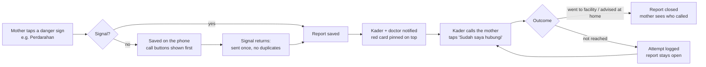

# NutriSense & N.E.X.U.S.: Product Requirements Document (PRD)

| | |
|---|---|
| **Product** | NutriSense (health app) and N.E.X.U.S. (nutrition-package logistics) |
| **Owner** | Kenneth Kurniawan, BINUS International (thesis project, 2026) |
| **Version** | 1.0, 17 October 2026 |
| **Status** | Describes the working prototype at commit `90d64d9`. Every requirement marked **Built** exists in the code and is covered by the tests listed in [Tests](#12-verification). |
| **Related** | [Product review and backlog](PRODUCT.md) · [Data model (ERD)](ERD.md) · [User guide](USER_GUIDE.md) · [Facility integration](FACILITY_INTEGRATION.md) · [Feature checks](PENGUJIAN-FITUR.md) |

How to read this document:
- **Priority** uses MoSCoW: **M** must, **S** should, **C** could.
- **Status**: **Built** (in the prototype and tested), **Partial** (built with a known gap, named in the row), **Planned** (in the
  backlog, [PRODUCT.md §6](PRODUCT.md#6-backlog-top-10-ordered-by-impact)).
- Requirement IDs (for example `MAT-07`) are stable, so the thesis, tests and reviews can refer to them.
- Indonesian health terms are explained in the [glossary](#14-glossary).

---

## 1. Summary

NutriSense is one mobile app, in Bahasa Indonesia and English, for everyone who looks after a young child or a pregnant
mother in rural Nusa Tenggara Timur (NTT): the mother, the posyandu **Kader**, the **bidan** or doctor, and the district
health office (**Dinas Kesehatan**). It measures growth against the WHO standards, flags stunting risk early with
explainable AI, tells each person the one thing to do next, and makes sure a danger sign reaches someone who acts.
N.E.X.U.S. delivers supplementary food and supplements to a smart locker near the family, with a pickup code.

The app works offline on a low-end Android phone, and only the optional parts (photo recognition, free-text chat) need
the internet.

## 2. Problem

- **Stunting is common and found late.** In NTT, more than one in three children under five is stunted (the app uses
  the SSGI 2024 provincial figure, 37.0%, as its benchmark). Stunting is defined by height-for-age, so by the time it is
  measured, the growth already lost is hard to recover.
- **Monthly measurements do not turn into action.** Weights and heights are written in the Buku KIA and posyandu
  registers. A child who gains too little twice in a row (**2T**) or slides toward −2 SD is often noticed late.
- **Danger signs get lost.** A sick baby, or a pregnant mother who starts bleeding, depends on someone noticing and
  calling. A report written down, or sent once, can be missed, and many villages have weak or no signal.
- **Pregnancy risk starts the cycle.** Chronic energy deficiency (**KEK**), anaemia and missed antenatal visits lead to
  small babies, who are more likely to become stunted.
- **Help is hard to reach.** The Puskesmas can be hours away, and supplementary food reaches families irregularly.
- **Information sits in separate places**: the mother's Buku KIA, the Kader's register, the Puskesmas system and the
  Dinkes report. Nobody sees the whole picture of a family or a district.

## 3. Goals and non-goals

### Goals

| # | Goal | How we know (see [§9](#9-success-metrics)) |
|---|---|---|
| G1 | Find growth faltering and stunting risk **before** a child is stunted | Share of children measured each month (D/S); 2T and "sliding toward −2 SD" flags raised |
| G2 | Make sure every danger sign, for a child, a newborn or a pregnant mother, is **seen and followed up** | Share of maternal danger reports contacted within 2 hours and closed with an outcome within 24 hours |
| G3 | Help mothers feed their child and themselves well with **local, affordable food** | Food-group diversity (≥ 5 of 8 groups); iron tablets (TTD) logged in pregnancy |
| G4 | Keep pregnancies on track: K1–K6 visits, LiLA, Hb, birth plan, nifas visits | K6 coverage; K1 in trimester 1; KF1/KN1 marked within 48 hours |
| G5 | Give Kaders and the Dinkes **one prioritised view** of who needs help first | Time to find the next family to visit; dashboard use |
| G6 | Get nutrition packages to the right family through the nearest locker | Pickup rate; hours from ready to pickup |
| G7 | Protect health data and keep people in control of it | Consent recorded per scope; every read and write audited |

### Non-goals

- **Diagnosis.** AI output is decision support. Every result says so, and a clinician can confirm or change any
  assessment.
- **Replacing the Buku KIA, the Puskesmas system (SIMPUS) or SATUSEHAT.** NutriSense reads from and writes to them through
  standards (HL7 FHIR R4); it does not replace them.
- **Treatment and prescribing.** The app refers; doctors decide. Prescription-only items (for example RUTF) need a doctor's
  approval.
- **Real hardware and real submission in this prototype.** Smart lockers, road deliveries and the SATUSEHAT submission
  are simulated (see [§5.2](#52-out-of-scope-for-this-prototype)).

## 4. Users

| Role (in the app) | Who | Main jobs | Device and context |
|---|---|---|---|
| **Caregiver** (`caregiver`) | Mother or other carer of a child under five; a pregnant mother uses the same role | Know if the child grows well and what to do; report symptoms; feed well; follow the pregnancy; report a danger sign | Own or shared low-end Android phone, often without signal; limited reading time |
| **Kader** (`kader`) | Posyandu volunteer covering one or more villages | Measure many children fast on posyandu day; know who to visit first; follow up danger signs; register mothers | Own phone, works in the field and offline |
| **Doctor / bidan** (`doctor`) | Clinician at the Puskesmas | Review flagged children; refer; follow up danger reports; approve prescription-only items | Phone or desktop browser |
| **Health officer** (`officer`) | Dinas Kesehatan staff | See which villages and children need help first; approve packages; manage logistics | Desktop browser or tablet |
| **Admin** (`admin`) | System administrator | Manage users and model versions | Command line and browser |
| **Health facility system** | Puskesmas or hospital system (SIMPUS vendor) | Send antenatal check-ups to the mother's app | Server-to-server, HL7 FHIR R4, per-facility API key |

Personas used throughout this document and the demo:
- **Ibu Maria** (caregiver), Baumata: two children (Adel, healthy; Budi, at risk) and 24 weeks pregnant.
- **Kader Martha** (Kader), Oesapa: about 23 children and several pregnant mothers.
- **Ibu Yuliana** (caregiver): 33 weeks pregnant; her baby is born during the demo.
- **dr. Yohanes** (doctor) and the **Petugas Dinkes** (officer).

## 5. Scope

### 5.1 In scope (built in the prototype)

1. Accounts, roles and regions ([AUTH](#61-accounts-roles-and-access-auth))
2. Child profile and growth monitoring ([GRW](#62-child-profile-and-growth-monitoring-grw))
3. AI risk assessment and triage ([RSK](#63-ai-risk-assessment-and-triage-rsk))
4. Symptom checker, including newborns ([SYM](#64-symptom-checker-sym))
5. Nutrition: plan, NutriScan, meals, recipes ([NUT](#65-nutrition-and-nutriscan-nut))
6. Buku KIA schedule, ASI eksklusif and development ([KIA](#66-buku-kia-asi-and-development-kia))
7. Pregnancy, birth and nifas ([MAT](#67-pregnancy-birth-and-nifas-mat))
8. Check-ups from the health facility, HL7 FHIR R4 ([FAC](#68-check-ups-from-the-health-facility-fac))
9. Cases, review and the Kader's work list ([CAS](#69-cases-review-and-the-kaders-work-list-cas))
10. N.E.X.U.S. logistics and smart lockers ([LOG](#610-nexus-logistics-and-smart-lockers-log))
11. Dashboards for the Dinkes ([DSH](#611-dashboards-dsh))
12. Tanya Nuri, the assistant ([AST](#612-tanya-nuri-the-assistant-ast))
13. Consent, privacy, audit, notifications and FHIR export ([GOV](#613-consent-privacy-audit-and-notifications-gov))
14. Offline use and sync ([OFF](#614-offline-and-sync-off))
15. Language, accessibility and design ([UX](#615-language-accessibility-and-design-ux))

### 5.2 Out of scope for this prototype

| Item | Why | What the prototype does instead |
|---|---|---|
| Real smart-locker hardware and couriers | Hardware is outside the thesis scope | Lockers, stock and deliveries are simulated; officers can fast-forward a delivery |
| Live SATUSEHAT submission | Needs Ministry onboarding | The FHIR bundle is generated and validated; the submission is simulated and logged |
| A model trained on real children | No consented real cohort yet | The risk model is trained on a synthetic cohort shaped like rural NTT; dashboards label it "Data demo" |
| Push notifications and SMS | Not built yet | In-app notifications (planned: [PRODUCT.md backlog #4](PRODUCT.md#6-backlog-top-10-ordered-by-impact)) |
| Local languages (Uab Meto, Rote, Sabu, Helong) | Need translators and validation | Bahasa Indonesia and English, with text-to-speech ("Dengar") |

---

## 6. Functional requirements

### 6.1 Accounts, roles and access (AUTH)

| ID | Requirement | Priority | Status | Evidence |
|---|---|---|---|---|
| AUTH-01 | A mother can sign up with her name, phone number and password; email is optional. She picks her village and must agree to data processing. | M | Built | `POST /api/auth/register`, `register.tsx` |
| AUTH-02 | Users log in with a phone number or an email. | M | Built | `POST /api/auth/login` |
| AUTH-03 | Five roles (caregiver, Kader, doctor, officer, admin), each with its own tabs and permissions. | M | Built | `models.Role`, `deps.py`, `(tabs)/_layout.tsx` |
| AUTH-04 | A Kader sees only the villages she covers (her home village plus `covered_region_ids`). | M | Built | `User.coverage()`, `deps.py` |
| AUTH-05 | Repeated failed logins are blocked: 5 per account and 30 per IP address in 15 minutes. | M | Built | `routers/auth.py` lines 21–22 |
| AUTH-06 | Logout and password change revoke every existing session token. | M | Built | `User.token_version` |
| AUTH-07 | A user can change their name, phone, language and password in Settings. | S | Built | `PATCH /api/auth/me`, `POST /api/auth/change-password`, `settings.tsx` |
| AUTH-08 | A Kader registers a pregnant mother who has no email, by phone number, and reads her a temporary password. | M | Built | `POST /api/kader/mothers`, `mother/new.tsx` |
| AUTH-09 | A user who forgot their password can recover access. | S | Planned | Backlog #8 (must not let the Kader keep the password; force a change at next login) |

### 6.2 Child profile and growth monitoring (GRW)

| ID | Requirement | Priority | Status | Evidence |
|---|---|---|---|---|
| GRW-01 | A caregiver or Kader adds a child: name, sex, birth date, birth weight and length, gestational age at birth. A Kader finds the mother by phone number or email. | M | Built | `POST /api/children`, `child/new.tsx` |
| GRW-02 | Guided measurement in 4 steps: how to measure, enter the numbers, check, save. It records who measured (mother or Kader), lying or standing position, MUAC and oedema. | M | Built | `child/[id]/measure.tsx` |
| GRW-03 | Height-for-age, weight-for-age and weight-for-height z-scores from the official WHO 2006 LMS tables, with the length/height switch at 24 months (0.7 cm correction). | M | Built | `ai/growth.py` |
| GRW-04 | Impossible values are refused, and WHO implausibility flags are shown to staff. | M | Built | `ai/growth.py`, `GET /api/dashboard/flagged` |
| GRW-05 | The weight-gain check against the Buku KIA minimum (KBM) shows **N** or **T**, and **2T** after two inadequate gains in a row. | M | Built | `ai/kia.py` |
| GRW-06 | Growth charts on the WHO curves for height, weight and weight-for-height. | M | Built | `GET /api/children/{id}/growth-chart`, `child/[id]/history.tsx` |
| GRW-07 | Predictive tracker: height-for-age velocity, projected 3 and 6 months ahead, so a child sliding toward −2 SD is flagged early. | S | Built | `ai/trend.py` |
| GRW-08 | The result is in plain words with colour **and** text, never colour alone, with "Yang bisa dilakukan" (what you can do) actions. | M | Built | `components/AssessmentView.tsx` |
| GRW-09 | The home screen opens on the family member who needs attention most, then the "Untuk hari ini" checklist. | S | Partial | `(tabs)/home.tsx`; the status ignores a `doctor_48h` referral (backlog #2) |

### 6.3 AI risk assessment and triage (RSK)

| ID | Requirement | Priority | Status | Evidence |
|---|---|---|---|---|
| RSK-01 | Every measurement produces a risk assessment (low, medium, high) from a Random Forest with a logistic-regression baseline, using 19 factors known **before** the child's size (birth, ASI, weight gain, illness, diet, immunisation, the mother, the household). Height and z-scores are **not** inputs. | M | Built | `ai/risk_model.py`, `services/assessment.py` |
| RSK-02 | Safety guardrails can **raise** the level after the model but never lower it: WHO cut-offs (HAZ, WHZ, MUAC), oedema, 2T and IMCI danger signs. | M | Built | `ai/risk_model.py` |
| RSK-03 | Each result explains itself: the factors that pushed the risk up or down, and human-readable reasons. | M | Built | `RiskAssessment.explanation`, `.reasons` |
| RSK-04 | A result with confidence below 0.6, or where a guardrail overrode the model, is marked for human review. | M | Built | `config.review_confidence_threshold`, `GET /api/reviews/pending` |
| RSK-05 | A doctor or officer can confirm or change the level, with a note. | M | Built | `POST /api/assessments/{id}/review` |
| RSK-06 | Triage turns the result into one of four urgency tiers (`emergency`, `doctor_48h`, `kader_7d`, `routine`) with next steps and supply needs. For `doctor_48h`, "Bawa ke dokter/Puskesmas dalam 2 hari" is the first action. | M | Built | `ai/triage.py` |
| RSK-07 | Safety does not depend on the optional AI-analysis consent: WHO rules, triage, cases and Kader alerts always run. | M | Built | `routers/children.py` |
| RSK-08 | Model versions are registered with their metrics and feature importances; an admin can retrain. | S | Built | `ModelRun`, `GET /api/models`, `POST /api/models/retrain` |

### 6.4 Symptom checker (SYM)

| ID | Requirement | Priority | Status | Evidence |
|---|---|---|---|---|
| SYM-01 | The caregiver picks symptoms from picture tiles, or types in her own words. | M | Built | `child/[id]/symptoms.tsx`, `POST /api/children/{id}/symptoms` |
| SYM-02 | Offline reading of Bahasa Indonesia, English, slang and local terms (*mencret*, *step*, *lepeh*), ignoring negated and resolved symptoms (except danger signs). | M | Built | `ai/symptoms.py`, `tests/test_ai.py` |
| SYM-03 | A danger sign (for example convulsions) shows **"Perlu pertolongan"** at once, with Puskesmas, 119 and Kader call buttons, also offline. | M | Built | `components/SymptomTiles.tsx` |
| SYM-04 | Babies under 60 days get the WHO young-infant danger signs: fever, poor feeding, jaundice, red or pus-filled cord, cold body, grunting. The age comes from the child's record, not the typed text. | M | Built | `ai/symptoms.py` (`YOUNG_INFANT_DAYS = 60`); feature check B20 |
| SYM-05 | With the AI key and consent, Claude also reads free text; its findings are merged with the rules by union, so an AI miss can never hide a danger sign. | C | Built | `ai/llm.py` |

### 6.5 Nutrition and NutriScan (NUT)

| ID | Requirement | Priority | Status | Evidence |
|---|---|---|---|---|
| NUT-01 | NutriScan: the mother picks the foods she has at home (or takes a photo); the app proposes the best affordable dish for the child, what to buy and how to cook it. | M | Built | `POST /api/children/{id}/nutriscan`, `ai/kitchen.py` |
| NUT-02 | Photo recognition of foods (needs the AI key and internet); without it, the food list works offline. | C | Built | `ai/llm.py` |
| NUT-03 | 22 local NTT recipes with household measures (kelor, jagung bose…). | S | Built | `ai/recipes.py` |
| NUT-04 | Meal log with a food-group ring; the WHO target is at least 5 of 8 groups a day. | M | Built | `POST /api/children/{id}/meals` |
| NUT-05 | Nutrition plan: energy, protein, iron and vitamins against the AKG 2019 targets, from 32 local foods. | S | Partial | `GET /api/children/{id}/nutrition-plan`; percentages shown from 1 logged day can mislead (backlog) |

### 6.6 Buku KIA, ASI and development (KIA)

| ID | Requirement | Priority | Status | Evidence |
|---|---|---|---|---|
| KIA-01 | The Buku KIA schedule for immunisation, vitamin A and deworming; items can be marked as given or undone. | M | Partial | `child_care.py`, `ai/kia.py`; "terlewat" (missed) has no catch-up window and treats "not recorded" as missed (backlog #7) |
| KIA-02 | ASI eksklusif tracker for 0–5 months, one day at a time; the Kader is alerted when exclusive breastfeeding stops. | M | Built | `GET/POST /api/children/{id}/asi` |
| KIA-03 | Age-appropriate development checklist (not a diagnostic screening). | S | Built | `GET/POST /api/children/{id}/development` |
| KIA-04 | The next posyandu date shows on the home screen. | S | Built | `Region.posyandu_day` |

### 6.7 Pregnancy, birth and nifas (MAT)

| ID | Requirement | Priority | Status | Evidence |
|---|---|---|---|---|
| MAT-01 | A pregnancy is recorded from the HPHT; the gestational age, trimester and due date (HPL) are computed. | M | Built | `POST /api/pregnancies`, `ai/maternal.py` |
| MAT-02 | Antenatal visits K1–K6 with their due windows; visits can be marked as done. | M | Built | `POST /api/pregnancies/{id}/anc` |
| MAT-03 | LiLA and Hb are recorded and judged with the Kemenkes cut-offs: KEK when LiLA < 23.5 cm, anaemia when Hb < 11 g/dL. | M | Built | `POST /api/pregnancies/{id}/measurements` |
| MAT-04 | Daily iron tablet (TTD) and supplementary food (PMT) log, with the last 7 days. | M | Built | `POST /api/pregnancies/{id}/daily` |
| MAT-05 | One risk level for the mother, with its reasons; missed visits raise it. | M | Built | `ai/maternal.py` |
| MAT-06 | The mother reports a danger sign (bleeding, waters breaking, severe headache…). Without signal the report is kept on the phone and sent once when the signal returns, and the call buttons come first. | M | Built | `POST /api/pregnancies/{id}/danger`, `pregnancy/[id]/danger.tsx`; feature check D7 |
| MAT-07 | A danger report **stays open** (the mother stays urgent) until staff record contact and an outcome: went to the facility, advised at home, or not reached. "Not reached" only logs an attempt and keeps it open. A later minor complaint does not close it. Reports older than 14 days stop being urgent. | M | Built | `PATCH /api/pregnancies/{id}/danger/{rid}`; feature check F13 |
| MAT-08 | The Kader and the doctor are notified of every danger report; open reports are pinned at the top of the Kader home and the dashboard with "Telepon ibu". | M | Partial | `GET /api/kader/danger-open`, `DangerAlerts.tsx`; doctors and officers see every region (backlog #3) |
| MAT-09 | Birth plan: place, transport, companion, blood donor, funding. | S | Built | `Pregnancy.birth_plan` |
| MAT-10 | Recording the birth creates the baby's child profile; a small or premature baby is flagged and the Kader is told. | M | Built | `POST /api/pregnancies/{id}/birth` |
| MAT-11 | Nifas visits for the mother (KF1–KF4) and the baby (KN1–KN3) can be marked. | M | Built | `POST /api/pregnancies/{id}/nifas` |
| MAT-12 | Postpartum danger signs can be reported and followed up like pregnancy danger signs. | M | Planned | Backlog #1 |

### 6.8 Check-ups from the health facility (FAC)

| ID | Requirement | Priority | Status | Evidence |
|---|---|---|---|---|
| FAC-01 | With her consent, the mother turns on the link to the Puskesmas and shows a code (`NS-…`) or its QR to the midwife. The code identifies the pregnancy without her NIK, and she can turn the link off at any time. | M | Built | `POST /api/pregnancies/{id}/link`, `pregnancy/[id]/puskesmas.tsx` |
| FAC-02 | The facility's system sends each antenatal check-up as an HL7 FHIR R4 Bundle; it authenticates with its own API key, of which only the SHA-256 hash is stored. | M | Built | `POST /api/integrations/fhir`, `services/facility_sync.py` |
| FAC-03 | Sending the same check-up again updates it, never duplicates it; a code is never given out twice, so an old code cannot send results to another mother. | M | Built | `AncExam` unique (`facility_id`, `external_id`); `FacilityLinkCode` |
| FAC-04 | The results arrive on the mother's phone in plain words (for example "150/95: normally below 140/90"), with a call-the-midwife button; urgent results notify the Kader. | M | Built | `pregnancy/[id]/puskesmas.tsx` |
| FAC-05 | A demo portal lets a midwife enter a check-up by hand to show the flow. | C | Built | `POST /api/facility-portal/checkup`, `facility-portal.tsx` (demo only) |

### 6.9 Cases, review and the Kader's work list (CAS)

| ID | Requirement | Priority | Status | Evidence |
|---|---|---|---|---|
| CAS-01 | A high-risk, emergency or review result opens a case for the child, assigned to the Kader and visible to the doctor. | M | Built | `services/assessment.py`, `GET /api/cases` |
| CAS-02 | Case status: open, in progress, referred, resolved, closed; staff add notes. | M | Built | `PATCH /api/cases/{id}` |
| CAS-03 | A note can be shared with the family; it appears in the mother's app as advice from the health worker. | S | Built | `CaseNote.visible_to_caregiver` |
| CAS-04 | The Kader home lists children by priority, with search and filters. | M | Partial | `KaderHome.tsx`; search runs inside the "Prioritas" filter (backlog #6) |
| CAS-05 | A child's emergency or `doctor_48h` case records contact and outcome, like maternal danger reports. | M | Planned | Backlog #2 |

### 6.10 N.E.X.U.S. logistics and smart lockers (LOG)

| ID | Requirement | Priority | Status | Evidence |
|---|---|---|---|---|
| LOG-01 | A supply request is created for a child from the triage's supply needs or by staff: PMT biscuits, micronutrient powder (Taburia), ORS and zinc, kelor powder, vitamin A, deworming, RUTF. | M | Built | `POST /api/supply-requests`, `ai/triage.py` |
| LOG-02 | The system compares stock in a locker within 12 km of the family with a road delivery from a supply hub, and proposes the best route with its reasons. | M | Built | `services/logistics.py`, `GET /api/supply-requests/{id}/plan` |
| LOG-03 | The officer approves or rejects; prescription-only items need a doctor. | M | Built | `POST /api/supply-requests/{id}/approve`, `/reject` |
| LOG-04 | The mother gets a signed QR and a 6-digit pickup code, with an expiry. | M | Built | `SupplyRequest.pickup_code`, `.qr_payload`, `.expires_at`; `pickups.tsx` |
| LOG-05 | At the locker, the Kader scans the QR or types the code; the locker opens and the stock is updated. | M | Built | `POST /api/lockers/by-code/{code}/pickup`, `scan.tsx` |
| LOG-06 | Stock with reservations, restock thresholds and restock alerts; officers can simulate deliveries. | S | Built | `InventoryItem`, `GET /api/logistics/restock-alerts`, `POST /api/logistics/simulate` |

### 6.11 Dashboards (DSH)

| ID | Requirement | Priority | Status | Evidence |
|---|---|---|---|---|
| DSH-01 | Regional KPIs: children, stunting, emergencies, cases, with their sources and years. | M | Built | `GET /api/dashboard/summary` |
| DSH-02 | Village risk map compared with the SSGI benchmark. | S | Built | `GET /api/dashboard/heatmap` |
| DSH-03 | Priority list of children to act on first. | M | Built | `GET /api/dashboard/priority` |
| DSH-04 | Maternal indicators: KEK, anaemia, K1 and K6 coverage, flagged mothers. | M | Built | `GET /api/dashboard/mothers` |
| DSH-05 | Model card and evaluation (human review rate, human–AI agreement), behind "Detail teknis". | S | Built | `GET /api/dashboard/model`, `/evaluation` |
| DSH-06 | Coverage reports for upward reporting: D/S, N/D, immunisation coverage, monthly trend, CSV export. | S | Planned | Backlog #9 |

### 6.12 Tanya Nuri, the assistant (AST)

| ID | Requirement | Priority | Status | Evidence |
|---|---|---|---|---|
| AST-01 | Nuri answers questions about growth, feeding, symptoms, development, pregnancy, ASI and KIA in short, simple sentences, from a built-in FAQ that works offline. | M | Built | `ai/assistant.py`, `POST /api/assistant/chat` |
| AST-02 | A danger question is always answered first with "Segera ke Puskesmas atau telepon 119". | M | Built | `ai/assistant.py` |
| AST-03 | With the AI key and consent, Claude answers open questions using the child's latest results; any error or refusal falls back to the FAQ. | C | Built | `ai/llm.py` |
| AST-04 | Suggestion chips for pregnant mothers. | S | Planned | Backlog #10 |

### 6.13 Consent, privacy, audit and notifications (GOV)

| ID | Requirement | Priority | Status | Evidence |
|---|---|---|---|---|
| GOV-01 | Consent is recorded per scope: data processing (required), AI analysis, SATUSEHAT sharing, research use; each can be changed in "Data & privasi". | M | Built | `Consent`, `GET/POST /api/consents`, `privacy.tsx` |
| GOV-02 | AI calls and SATUSEHAT sharing are blocked without their consent. | M | Built | `routers/governance.py`, `FhirSyncLog.status = blocked_no_consent` |
| GOV-03 | Every read and write of child or pregnancy data is written to the audit log. | M | Built | `AuditLog`, `GET /api/audit-logs` |
| GOV-04 | Free-text health notes (symptom descriptions, case notes, chat, facility notes) are encrypted at rest. | M | Built | `security.EncryptedText` (Fernet) |
| GOV-05 | Right to deletion: a caregiver can delete a child and its data. | M | Built | `DELETE /api/children/{id}` |
| GOV-06 | FHIR R4 export of a child (`Patient`, `Observation` with LOINC codes, `RiskAssessment`, `Consent`) and a simulated SATUSEHAT sync. | S | Built | `GET /api/children/{id}/fhir`, `services/fhir.py` |
| GOV-07 | In-app notifications for results, cases, danger reports, packages and facility results. | M | Built | `Notification`, `GET /api/notifications` |
| GOV-08 | Push notifications for danger reports, then reminders (posyandu, vaccines, ANC, TTD). | S | Planned | Backlog #4 |

### 6.14 Offline and sync (OFF)

| ID | Requirement | Priority | Status | Evidence |
|---|---|---|---|---|
| OFF-01 | Measurements, meals, symptoms, mother measurements, ANC, TTD/PMT, ASI, KIA and danger reports can be recorded without signal. | M | Built | `mobile/src/lib/offline.ts` |
| OFF-02 | Queued items are replayed when the signal returns, exactly once, using a client UUID (or the day) as the idempotency key. | M | Built | `client_uuid` columns, `POST /api/sync` |
| OFF-03 | A sync page shows what is waiting and what was sent; a banner shows the offline state. | M | Built | `sync.tsx` |
| OFF-04 | Screens already loaded stay readable offline (cached). | S | Built | `lib/offline.ts` |
| OFF-05 | Staff follow-up actions (contact, outcome) also work offline. | S | Planned | Backlog #3 |

### 6.15 Language, accessibility and design (UX)

| ID | Requirement | Priority | Status | Evidence |
|---|---|---|---|---|
| UX-01 | The whole app in Bahasa Indonesia and English, switchable in one tap. | M | Built | `lib/i18n.ts`, `settings.tsx` |
| UX-02 | Large text option; status always in colour **and** words; touch targets for low-end phones. | M | Built | `settings.tsx`, `lib/status.ts` |
| UX-03 | "Dengar": results and advice read aloud for low literacy, with a check for an Indonesian voice. | S | Built | text-to-speech button |
| UX-04 | Every AI result says it is not a medical diagnosis. | M | Built | `AssessmentView.tsx` |
| UX-05 | One consistent, soft lavender design with the Nuri mascot; one action-first screen per task. | S | Built | `theme.ts`, `components/` |

---

## 7. Non-functional requirements

| ID | Area | Requirement | Status |
|---|---|---|---|
| NFR-01 | **Offline** | Every safety-critical step (danger signs, emergency numbers, measurement, triage rules) works without the internet. The AI key and internet only add photo recognition and open chat. | Built |
| NFR-02 | **Devices** | Runs on Android, iOS and the web from one Expo (React Native) code base; usable on a low-end Android phone. | Built |
| NFR-03 | **Security: authentication** | Passwords hashed with PBKDF2-SHA256 (240,000 iterations); signed JWT sessions (7 days) revocable by `token_version`; login throttling (AUTH-05). | Built |
| NFR-04 | **Security: data** | Fernet encryption of free-text health notes; per-facility API keys stored as SHA-256 hashes; production refuses to start without its secrets; CORS limited to known origins; HTTPS at the host. | Built |
| NFR-05 | **Privacy** | Consent per scope (GOV-01); role-based access with Kader coverage (AUTH-04); audit log (GOV-03); right to deletion (GOV-05); the facility link uses a code, not the NIK. Designed with Indonesia's Personal Data Protection Law (UU PDP 27/2022) in mind; a legal review is still needed before real data. | Built (legal review pending) |
| NFR-06 | **Clinical safety** | Rules can raise but never lower an AI risk level; AI output is labelled as decision support; low-confidence results go to human review; danger wording follows Buku KIA and WHO IMCI and **needs clinical sign-off** before field use. | Built (sign-off pending) |
| NFR-07 | **Interoperability** | HL7 FHIR R4 for facility check-ups (inbound) and child export (outbound); LOINC codes for observations. | Built |
| NFR-08 | **Reliability** | Idempotent writes for offline replay and facility resends; health (`/api/health`) and readiness (`/api/health/ready`) endpoints; documented backup and restore. | Built |
| NFR-09 | **Deployability** | One Docker image serves the API and the web app; SQLite for demos, PostgreSQL over TLS for production; runs on Codespaces, Render or Hugging Face. | Built |
| NFR-10 | **Explainability** | Each risk result lists its reasons and factor contributions; the model card shows the training data (synthetic), metrics and version. | Built |
| NFR-11 | **Quality** | Automated tests for the backend, end-to-end flows, QA cases and feature checks run in CI on every push (see [§12](#12-verification)). | Built |

---

## 8. Key user flows

### 8.1 Monthly growth check (mother or Kader)
1. Open the child, tap **Catat tumbuh**.
2. Follow the 4 steps: how to measure, enter weight and height, check, save (offline too).
3. The app computes the WHO z-scores, the 2T check and the risk, and shows the result in plain words.
4. If the triage says `doctor_48h` or `emergency`, the first action is the referral with a call button, a case opens
   for the Kader, and the doctor sees it.

### 8.2 Maternal danger sign, end to end (built: MAT-06 to MAT-08)

### 8.3 Check-up at the Puskesmas (FAC)
1. The mother turns on **Hubungkan ke Puskesmas** and shows her `NS-…` code or QR.
2. The midwife's system sends the check-up (FHIR R4) with its API key.
3. The mother gets a notification; the results are explained in plain words with a call-the-midwife button.

### 8.4 Nutrition package (LOG)
1. A case leads to a supply request.
2. The officer sees the best route (locker stock or road delivery) and approves.
3. The mother gets a QR and a 6-digit code; at the posyandu locker, the Kader scans or types it and the locker opens.

### 8.5 Birth (MAT-10, SYM-04)
1. The mother records the birth: name, weight, length, place, attendant.
2. The baby's profile is created; a small or premature baby is flagged.
3. Nifas visits (KF/KN) are scheduled; newborn danger tiles (jaundice, cord, cold body, fever) are shown for the first
   60 days.

---

## 9. Success metrics

Measured per village and per Kader, monthly, unless noted. The full list, with how each is computed, is in
[PRODUCT.md §5](PRODUCT.md#5-success-measures).

| Goal | Metric | Target (to validate in the pilot) |
|---|---|---|
| G1 | **D/S**: share of children 0–59 months measured this month | ≥ 80% |
| G1 | **N/D**: share of weighed children with adequate weight gain; count of 2T | Rising month on month |
| G2 | Maternal danger reports with staff contact ≤ 2 h, and an outcome ≤ 24 h | ≥ 90% |
| G2 | Child emergency and `doctor_48h` cases seen by a doctor ≤ 48 h | ≥ 80% (needs CAS-05) |
| G3 | Children eating ≥ 5 of 8 food groups on logged days | Rising |
| G3 | KEK and anaemic mothers with ≥ 90 TTD logged | ≥ 70% |
| G4 | K6 coverage; K1 in trimester 1; KF1 and KN1 within 48 h | Above the district baseline |
| G5 | Median time for a Kader to measure one child | < 90 s |
| G6 | Package pickup rate; median hours from ready to pickup | ≥ 90%; < 48 h |
| G7 | Share of AI calls with consent; share of child-data reads audited | 100%; 100% |
| Model | Human review rate and human–AI agreement | Reported on the dashboard |

## 10. Release plan

| Phase | Content | Status |
|---|---|---|
| **P0: thesis prototype** | Everything marked **Built** above; demo data; simulated lockers and SATUSEHAT | Done (commit `90d64d9`) |
| **P1: safety hardening** | Postpartum danger signs (MAT-12); child referral follow-up (CAS-05); offline staff follow-up and regional scoping (OFF-05, MAT-08); clinical sign-off of the danger wording | Next ([backlog #1–#3](PRODUCT.md#6-backlog-top-10-ordered-by-impact)) |
| **P2: reach** | Push, then reminders (GOV-08); fewer, better alerts; search fix (CAS-04); KIA catch-up (KIA-01); password recovery (AUTH-09) | Planned (backlog #4–#8) |
| **P3: pilot** | One Puskesmas area: real accounts, consented data, a model trained on real data, coverage reports (DSH-06), real or posyandu pickup | Depends on the open questions in [§13](#13-open-questions) |

## 11. Assumptions, risks and dependencies

| Type | Item | Mitigation |
|---|---|---|
| Assumption | Most mothers have a smartphone, their own or shared | To validate in the pilot; Kader-assisted accounts (AUTH-08) and SMS are the fallback |
| Assumption | Kaders measure monthly at the posyandu | Guided, fast measurement (GRW-02); offline (NFR-01) |
| Risk | The model is trained on synthetic data | Labelled "Data demo"; rules always run; guardrails only raise; human review below 0.6 confidence |
| Risk | Danger wording not yet clinically signed off | Marked in NFR-06; sign-off before field use |
| Risk | Alert overload hides the real emergency (45 officer notifications in the demo) | Backlog #5: alerts only when a person must act, plus a digest |
| Risk | Nobody opens the app when a danger report comes in | Push (GOV-08), escalation chain (open question 6) |
| Dependency | Puskesmas systems able to send FHIR R4 | Documented API ([FACILITY_INTEGRATION.md](FACILITY_INTEGRATION.md)); demo portal |
| Dependency | Optional Claude API key | Every AI feature has an offline fallback |

## 12. Verification

| Suite | What it checks | Result at `90d64d9` |
|---|---|---|
| Backend tests (`backend/tests`, pytest) | API, AI rules, security, FHIR, logistics | 420 passed |
| End-to-end (`e2e/app.e2e.mjs`) | Every role's main flows in a browser | 48/48 steps |
| QA cases (`e2e/qa.e2e.mjs`) | Edge cases and regressions | 37/37 |
| Feature checks (`e2e/features.e2e.mjs`, [PENGUJIAN-FITUR.md](PENGUJIAN-FITUR.md)) | One check per feature, including B20 (newborn danger signs) and F13 (maternal danger follow-up) | 83/83 |

## 13. Open questions

The owner's open questions are kept in [PRODUCT.md §7](PRODUCT.md#7-open-questions-for-the-owner). The ones that change
this PRD most:
1. Which Puskesmas area is the first real deployment (decides push vs SMS, and whether lockers are real)?
2. What share of mothers have their own smartphone?
3. Who signs off the danger wording (Buku KIA, MTBS)?
4. If nobody records contact on a danger report within 2 hours, who is next in the escalation chain?
5. Which reports must the app produce for the Puskesmas and Dinkes (e-PPGBM, PWS KIA, SKDN)?

## 14. Glossary

| Term | Meaning |
|---|---|
| **2T** | *Dua kali tidak naik*: weight did not increase enough twice in a row |
| **AKG** | *Angka Kecukupan Gizi*: Indonesian recommended dietary allowances (2019) |
| **ANC, K1–K6** | Antenatal care visits, first to sixth |
| **ASI eksklusif** | Exclusive breastfeeding for the first 6 months |
| **Bidan** | Midwife |
| **Buku KIA** | Maternal and child health handbook |
| **D/S, N/D, SKDN** | Posyandu indicators: children weighed / all children; children gaining weight / weighed |
| **Dinkes** | *Dinas Kesehatan*, the district or provincial health office |
| **HPHT / HPL** | First day of the last menstrual period / estimated due date |
| **Hb** | Haemoglobin; anaemia in pregnancy when below 11 g/dL |
| **KBM** | *Kenaikan Berat badan Minimal*: minimum monthly weight gain |
| **Kader** | Community health volunteer at the posyandu |
| **KEK** | *Kurang Energi Kronis*: chronic energy deficiency, LiLA below 23.5 cm |
| **KF / KN** | Postnatal visits for the mother (*kunjungan nifas*) and the newborn (*kunjungan neonatal*) |
| **LiLA / MUAC** | Mid-upper arm circumference |
| **MTBS / IMCI** | Integrated Management of Childhood Illness |
| **NIK** | National identity number |
| **Nifas** | The 42 days after birth |
| **PMT** | *Pemberian Makanan Tambahan*: supplementary food |
| **Posyandu** | Monthly village health post |
| **Puskesmas** | Community health centre |
| **SATUSEHAT** | The Ministry of Health's national health data platform (FHIR-based) |
| **SSGI / SKI** | National nutrition and health surveys |
| **TTD** | *Tablet Tambah Darah*: iron-folic acid tablets |
| **Untuk hari ini** | "For today": the home-screen checklist |
